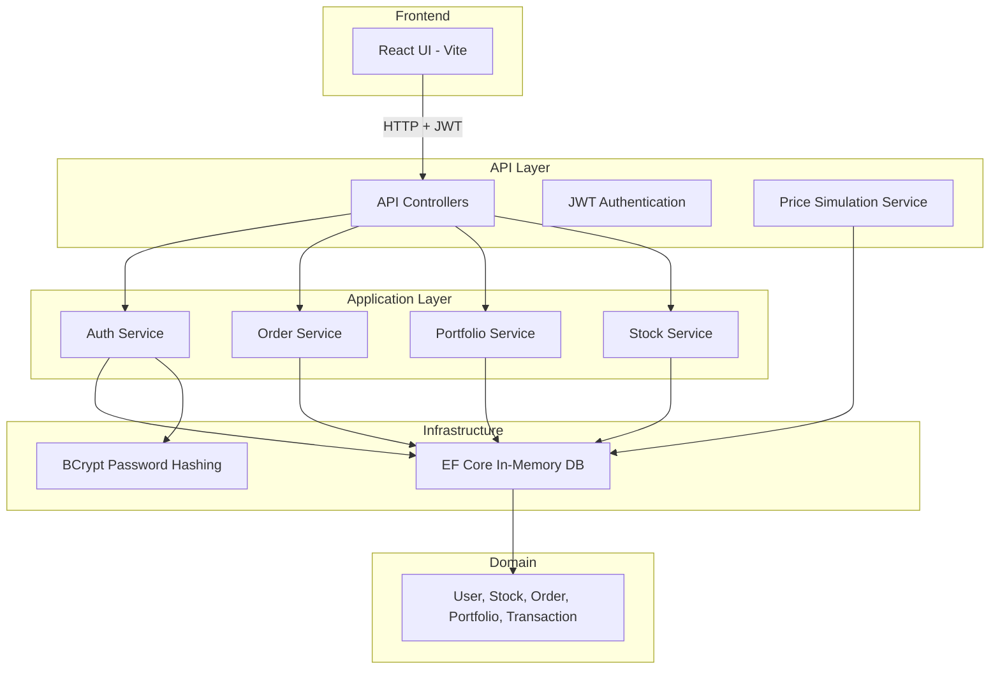

# MiniTradingPlatform

A full-stack mini trading platform built with **ASP.NET Core 8**, **Entity Framework Core (In-Memory)**, and **React**. Users can register, buy/sell stocks with simulated live prices, view their portfolio, and track profit/loss.

## Architecture



## Features

- **User registration & login** with JWT authentication
- **View available stocks** with live price simulation (updates every 3 seconds)
- **Buy and sell stocks** with validation (insufficient funds / shares)
- **Portfolio dashboard** showing holdings, cash balance, and total value
- **Transaction history** for all buy/sell activity
- **Profit/Loss calculation** — per-holding, total, and today's P/L
- **Unit tests** for orders, P/L, and validation scenarios

## Technologies

| Layer | Technology |
|-------|-----------|
| Backend | ASP.NET Core 8 Web API |
| ORM | Entity Framework Core 8 (In-Memory Database) |
| Auth | JWT Bearer + BCrypt |
| Frontend | React 19 + TypeScript + Vite |
| Testing | xUnit + EF Core In-Memory |
| Background Service | `IHostedService` for price simulation |

## Project Structure

```
TradingPlatform/
├── API/                  # Web API controllers, middleware, Program.cs
├── Application/          # Business logic, DTOs, service interfaces
├── Domain/               # Entity models
├── Infrastructure/       # EF Core, JWT, password hashing, background service
├── ReactUI/              # React frontend
└── Tests/                # Unit tests
```

## Screenshots

> After running the app, you'll see:
> - A dark-themed login/register screen
> - Dashboard with portfolio value (₹), today's P/L, and holdings
> - Stock cards with live-updating prices
> - Buy/Sell modals and transaction history table

## Prerequisites

- [.NET 8 SDK](https://dotnet.microsoft.com/download/dotnet/8.0)
- [Node.js 18+](https://nodejs.org/)

## Setup Instructions

### 1. Clone and navigate

```bash
cd C:\Users\ragha\Documents\TradingPlatform
```

### 2. Run the API

```bash
cd API
dotnet run
```

The API starts at **http://localhost:5000**. Swagger UI is available at http://localhost:5000/swagger.

### 3. Run the React UI

In a separate terminal:

```bash
cd ReactUI
npm install
npm run dev
```

The UI starts at **http://localhost:5173** and proxies API requests to the backend.

### 4. Run tests

```bash
dotnet test
```

## API Endpoints

| Method | Endpoint | Auth | Description |
|--------|----------|------|-------------|
| `POST` | `/register` | No | Register a new user (starts with ₹1,00,000) |
| `POST` | `/login` | No | Login and receive JWT token |
| `GET` | `/stocks` | No | List all available stocks |
| `GET` | `/stocks/{id}` | No | Get stock by ID |
| `POST` | `/orders/buy` | Yes | Place a buy order |
| `POST` | `/orders/sell` | Yes | Place a sell order |
| `GET` | `/portfolio` | Yes | Get portfolio with P/L |
| `GET` | `/transactions` | Yes | Get transaction history |

### Example: Register

```bash
curl -X POST http://localhost:5000/register \
  -H "Content-Type: application/json" \
  -d '{"username":"demo","email":"demo@test.com","password":"demo123"}'
```

### Example: Buy Stock

```bash
curl -X POST http://localhost:5000/orders/buy \
  -H "Content-Type: application/json" \
  -H "Authorization: Bearer <your-token>" \
  -d '{"stockId":1,"quantity":10}'
```

## Live Price Simulation

A background service (`PriceSimulationService`) runs as an `IHostedService` and updates stock prices every 3 seconds with small random fluctuations (±1%). This demonstrates:

- Background services in ASP.NET Core
- Dependency injection with scoped DbContext
- Real-time price updates visible in the UI (auto-refreshes every 3s)

## Database

This project uses **EF Core In-Memory Database** — no SQL Server or SQLite setup required. Data resets when the API restarts. Six stocks are seeded on startup: MSFT, AAPL, TSLA, GOOGL, AMZN, NVDA.

## Tests

| Test | Description |
|------|-------------|
| `BuyOrder_ReducesCashAndAddsHolding` | Verifies buy order deducts cash and creates portfolio entry |
| `BuyOrder_ThrowsWhenInsufficientFunds` | Validates insufficient funds rejection |
| `SellOrder_IncreasesCashAndReducesHolding` | Verifies sell order credits cash and reduces shares |
| `SellOrder_ThrowsWhenInsufficientShares` | Validates insufficient shares rejection |
| `SellOrder_ThrowsWhenNoHolding` | Validates sell with zero holdings |
| `GetPortfolio_CalculatesProfitLossCorrectly` | Verifies P/L and today's P/L math |
| `GetPortfolio_ReturnsEmptyHoldingsForNewUser` | Verifies empty portfolio for new users |

## License

MIT
